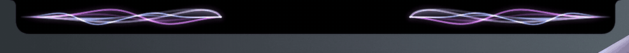
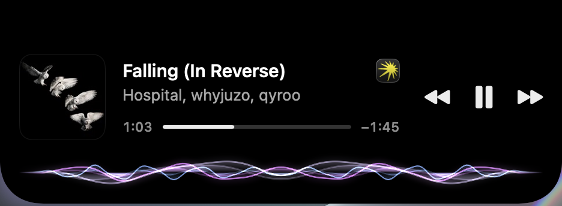
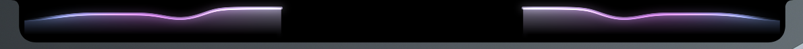
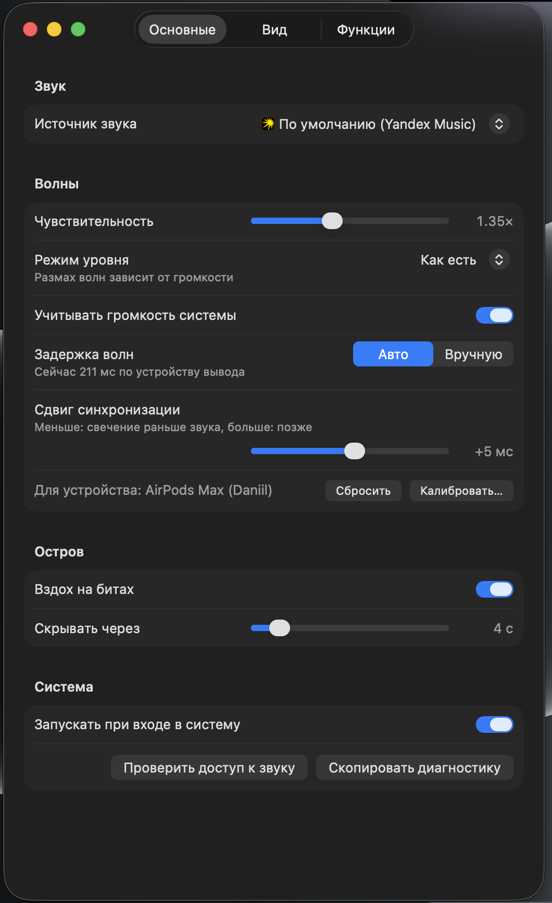
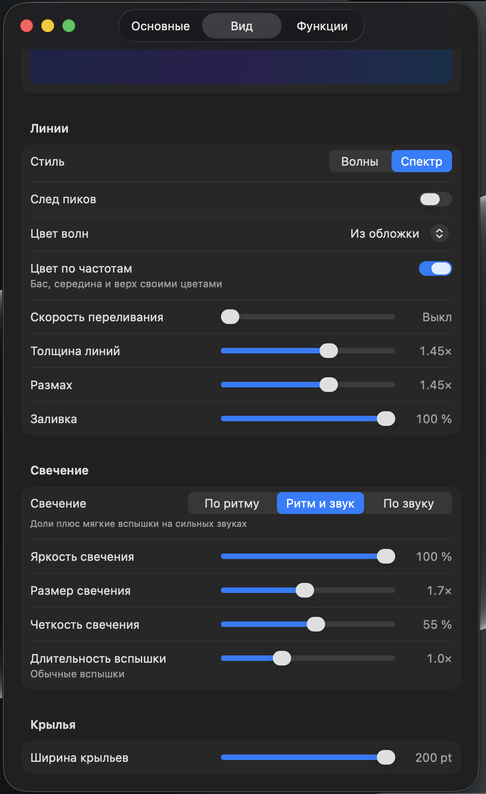
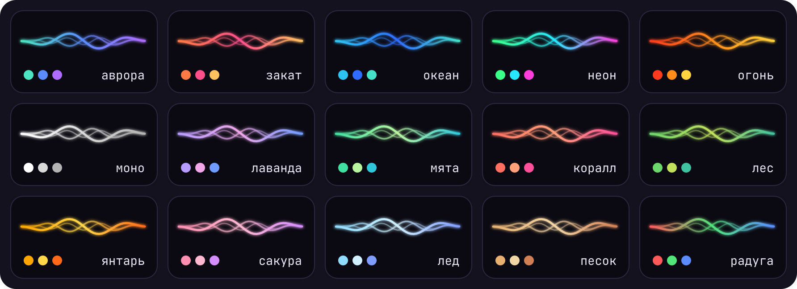

<div align="center">

# WaveFeels

Волны и свечение вокруг выреза MacBook в такт музыке.


<br><br>

[Возможности](#-возможности) | [Скриншоты](#-скриншоты) | [Палитры](#-палитры) | [Быстрый запуск](#-быстрый-запуск) | [Требования](#-требования) | [Как это работает](#-как-это-работает) | [Настройки](#-настройки) | [Если что-то не так](#-если-что-то-не-так)

<br>



</div>

WaveFeels живет в строке меню и рисует волны вокруг выреза камеры. Звук берется из любого приложения, которое вы выберете (плеер, браузер, Telegram), или из всей системы.

## ✨ Возможности

- Волны по басу, середине и верху, от одной до шести линий. Стили «Волны» и «Спектр».
- Цвета из обложки трека, одна из 15 палитр или свой цвет. Цвета могут переливаться или идти по частотам.
- Свечение под вырезом в такт: по найденным долям, по сильным звукам или по тому и другому.
- Наведите курсор на вырез, и остров раскроется: обложка, название, прогресс и кнопки управления.
- Баннер нового трека, свайп по острову для смены трека, полоса прогресса.
- Сдвиг синхронизации для каждого устройства вывода и калибровка по метроному.
- Частота кадров 30 или 60, облегченная отрисовка в режиме энергосбережения.

## 🖼 Скриншоты

<table>
  <tr>
    <td align="center" colspan="2"><br>Раскрытая панель</td>
  </tr>
  <tr>
    <td align="center" colspan="2"><br>Стиль «Спектр»</td>
  </tr>
  <tr>
    <td align="center" width="50%"><br>Настройки, «Основные»</td>
    <td align="center" width="50%"><br>Настройки, «Вид»</td>
  </tr>
</table>

## 🎨 Палитры

По умолчанию цвета берутся из обложки трека. Вместо них можно выбрать одну из 15 палитр или свой цвет на вкладке «Вид».

<div align="center">

</div>

## 🚀 Быстрый запуск

Готовых архивов для 1.3 пока нет, приложение собирается на своем маке. Полный Xcode не нужен.

1. **Поставьте инструменты сборки** (в них есть и git). Откройте Терминал (Cmd+Пробел, «Терминал») и выполните, если инструментов еще нет:
   ```
   xcode-select --install
   ```
2. **Склонируйте репозиторий:**
   ```
   git clone https://github.com/wFeeL/music-wave.git
   cd music-wave
   ```
   Клонируется ветка main, в ней последняя выпущенная версия. Перед следующей сборкой обновите код командой `git pull`.
3. **Соберите и установите:**
   ```
   bash scripts/build-local.sh --install
   ```
   Скрипт соберет приложение, подпишет его, положит в «Программы» и запустит. Первая сборка идет несколько минут.

   Ключ подписи в репозитории не хранится. При первой сборке на маке укажите папку, где он лежит:
   ```
   bash scripts/build-local.sh --signing-dir <папка с ключом>/signing --install
   ```
   Дальше скрипт берет ключ из «~/Library/Application Support/WaveFeels/signing» сам.
4. **Разрешите доступ к звуку.** При первом запуске macOS спросит про «Запись системного аудио», нажмите «Разрешить». Если запрос пропал, включите WaveFeels в Системных настройках: «Конфиденциальность и безопасность», «Запись экрана и системного аудио», раздел «Только запись системного аудио».
5. **Выберите источник и включите музыку.** В «Настройках» на вкладке «Основные» выберите приложение, из которого идет музыка, или «Весь звук системы». Остров выйдет из выреза, как только заиграет звук.

Если сборка не удалась, в выводе будет строка «ОШИБКА:» с подсказкой, а весь вывод сохранится в `dist/build-local.log`.

Когда появятся готовые архивы в Releases: перенесите WaveFeels.app в «Программы», выполните `xattr -dr com.apple.quarantine /Applications/WaveFeels.app` и откройте приложение.

## 📋 Требования

| Что | Версия |
| --- | --- |
| macOS | 26 или новее |
| Процессор | Apple Silicon |
| Для сборки | Command Line Tools (`xcode-select --install`) |
| По желанию | cmake (`brew install cmake`): без него название и обложка трека появятся, только если в «Программах» уже есть WaveFeels 0.9 или новее |

Приложение подписано своим сертификатом, не нотаризовано и не из App Store. Звук никуда не отправляется и не сохраняется, кроме записи ритма по кнопке в «Диагностике».

## 🎛 Как это работает

Звук перехватывается системным захватом macOS и остается таким же для ваших ушей. Волны показывают громкость полос в момент, когда вы слышите звук. Свечение предсказывает следующую долю, а в режиме «Ритм и звук» еще вспыхивает мягко на сильных ударах.

## ⚙️ Настройки

Окно «Настройки…» в меню значка. Изменения применяются сразу.

| Вкладка | Что там |
| --- | --- |
| Основные | Источник звука, чувствительность, задержка и сдвиг синхронизации с калибровкой, запуск при входе |
| Вид | Живой предпросмотр, стиль и цвета линий, режим и вид свечения, ширина крыльев |
| Функции | Частота кадров, задержка раскрытия, полоса прогресса, баннер, свайп, автовыбор источника, мягкий пульс |

Режимы свечения: «По ритму» вспыхивает только на найденных долях, «Ритм и звук» (по умолчанию) добавляет мягкие вспышки на сильных звуках, «По звуку» вспыхивает на ударах и нотах баса, как волны.

## 🩺 Если что-то не так

- **Вспышки мимо удара.** Нажмите «Калибровать…» в строке «Сдвиг синхронизации» и подгоните вспышку под щелчок метронома.
- **Нужен разбор ритма.** В «Диагностике» нажмите «Записать 2 мин» (длину можно выбрать). В `~/Library/Logs/WaveFeels/` появятся `.json` и `.wav`, пришлите оба.
- **Другая проблема.** Кнопка «Скопировать диагностику» в «Диагностике…» копирует отчет с последними строками лога. Полный лог лежит в `~/Library/Logs/WaveFeels/wavefeels.log`.

Обновление: `git pull` в папке с кодом и тот же `bash scripts/build-local.sh --install`, скрипт заменит старую копию. Настройки и доступ к звуку сохранятся.

Удаление:
```
rm -rf /Applications/WaveFeels.app ~/Library/Preferences/com.wfeels.wavefeels.plist ~/Library/Logs/WaveFeels
tccutil reset AudioCapture com.wfeels.wavefeels
```

## 🚧 Ограничения

- Только Apple Silicon, macOS 26 и русский интерфейс.
- Название, обложка и кнопки работают через [mediaremote-adapter](https://github.com/ungive/mediaremote-adapter). Если обновление macOS его сломает, волны останутся, а название и обложка пропадут.
- Источник «браузер» слушает весь браузер, выбрать одну вкладку нельзя.
- Свечению нужно несколько секунд ровного ритма, чтобы найти доли. На ломаных ритмах выручает режим «Ритм и звук».
- Широкие крылья закрывают пункты строки меню рядом с вырезом, клики по ним проходят.

## 🧰 Для разработчиков

<details>
<summary>Тесты, замер нагрузки, подпись</summary>

Ядро (WaveCore) не зависит от macOS и тестируется на Linux:

```
bash scripts/test-linux.sh
```

Нагрузку на процессор меряет `scripts/cpu-probe.sh` на встроенном демо-звуке, не трогая ваши настройки. Перед замером закройте WaveFeels:

```
bash scripts/cpu-probe.sh --preset max dist/WaveFeels.app
```

Ключи `--preset user`, `--island expanded`, `--style spectrum`, `--set wf.ключ=значение` и `--sample` описаны в `bash scripts/cpu-probe.sh --help`. Итог пишется в `ci-out/`.

Разрешение на звук привязано к подписи, поэтому все сборки подписываются одним сертификатом. Его нельзя терять и менять: с новым macOS снова спросит доступ к звуку. Храните копию `wavefeels-signing.p12` и пароль вне репозитория. Для CI сертификат кладется в секреты `SIGNING_P12_BASE64` и `SIGNING_P12_PASSWORD`, ожидаемый хэш лежит в `signing/expected-leaf.txt`, `scripts/sign.sh` сверяет его после подписи.

</details>
