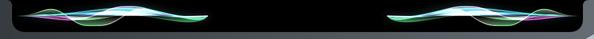
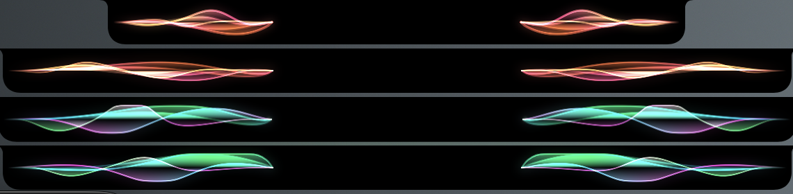
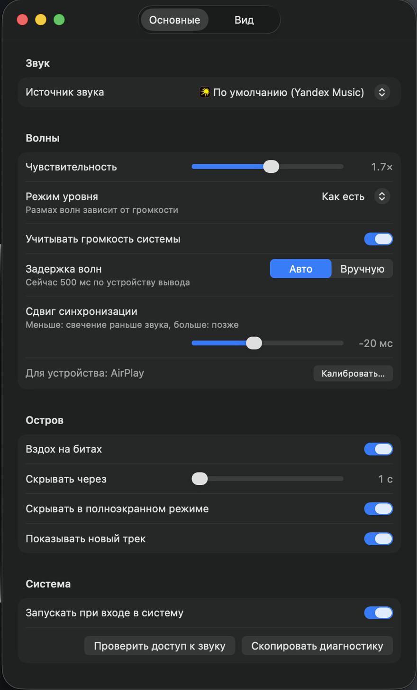
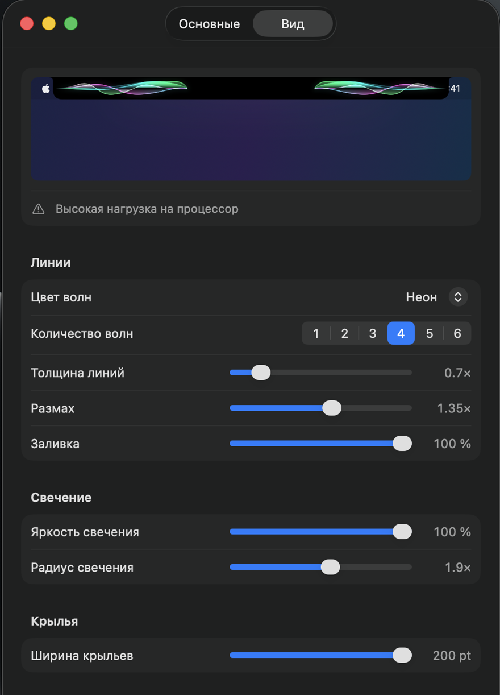

<div align="center">

# WaveFeels

Волны и свечение вокруг выреза MacBook в такт музыке.


<br><br>

[Возможности](#-возможности) | [Установка](#-требования-и-установка) | [Первый запуск](#-первый-запуск-и-доступ-к-звуку) | [Настройки](#-настройки) | [Ограничения](#-известные-ограничения) | [Для разработчиков](#-для-разработчиков)

<br>



</div>

WaveFeels рисует музыку вокруг выреза камеры. Пока играет Яндекс Музыка (или другой выбранный источник), из-под выреза расходятся полупрозрачные волны, по умолчанию три: бас, голос и инструменты, высокие частоты. Они строятся по реальному звуку выбранного приложения.

## ✨ Возможности

- Волны по трем диапазонам звука: бас, середина и верх. В настройках их можно сделать от одной до шести.
- Цвета берутся из обложки трека. Можно выбрать одну из 15 готовых палитр или свой цвет. Цвета могут медленно плыть по кругу (переливание) или зависеть от частоты: бас, середина и верх тогда рисуются каждый своим цветом.
- Два стиля: «Волны» и «Спектр». Стиль выбирается на вкладке «Вид».
- Под вырезом в такт музыке вспыхивает свечение. Когда ритм ровный, WaveFeels предсказывает следующую долю, и вспышка приходится на сам удар. Под вспышками идет мягкий пульс, так что остров не замирает, даже если ритм не ясен.
- Когда трек меняется, остров ненадолго показывает баннер с обложкой и названием.
- Если навести курсор на вырез, остров раскрывается: обложка, название, прогресс и кнопки управления. За раскрытой панелью мягко светятся цвета обложки.
- По нижнему краю свернутого острова может идти тонкая полоса прогресса трека цвета свечения (включается на вкладке «Функции», по умолчанию выключена).
- На вкладке «Функции» выбирается частота кадров (30 или 60) и включаются мягкая остановка на паузе, свечение обложки, свайп по острову для смены трека, автовыбор источника, задержка раскрытия и учет настроек доступности.
- «Сдвиг синхронизации» хранится для каждого устройства вывода отдельно. Его можно подобрать кнопкой «Калибровать…» по щелчку метронома.
- В режиме энергосбережения остров рисуется легче. Если выбранный вид сильно нагружает процессор, вкладка «Вид» об этом предупреждает.

<table>
  <tr>
    <td align="center" width="50%"><br>Раскрытая панель</td>
    <td align="center" width="50%"><br>Цвета волн</td>
  </tr>
  <tr>
    <td align="center"><br>Настройки, «Основные»</td>
    <td align="center"><br>Настройки, «Вид» с предпросмотром</td>
  </tr>
</table>

## 📦 Требования и установка

| Что | Версия | Зачем |
| --- | --- | --- |
| macOS | 26 или новее | Система, под которую сделано приложение |
| Процессор | Apple Silicon (arm64) | Intel не поддерживается |
| Яндекс Музыка | любая | Источник звука по умолчанию. Другой источник выбирается в настройках |
| Command Line Tools | из `xcode-select --install` | Только для сборки на своем маке |
| cmake | из Homebrew, по желанию | Только для сборки: без него нет названия и обложки трека, если в «Программах» нет готового адаптера |

Приложение не нотаризовано и не из App Store, поэтому установка частично ручная. Платный аккаунт разработчика для нее не нужен.

Версия 1.3 сейчас ставится сборкой на своем маке: пошаговая инструкция в разделе «Для разработчиков», подраздел «Сборка на своем маке». Готового архива 1.3 пока нет: сборки на маках в GitHub Actions недоступны, и последний релиз в GitHub Releases: 0.9.0. Когда релизы снова начнут собираться, установка из архива идет так.

Репозиторий закрытый, скачивать нужно из браузера, где вы вошли в GitHub.

1. На странице репозитория открыть Releases и скачать WaveFeels-<тег>.zip из самого свежего релиза. Бета публикуется как предварительный релиз (с пометкой Pre-release), она тоже подходит. Второй архив, WaveFeels-<тег>-update-test.zip, нужен только для проверки обновления, для обычной установки его не скачивают.
2. Распаковать архив двойным щелчком. Внутри один WaveFeels.app, его нужно перенести в «Программы».
3. В Терминале снять карантин:

```
xattr -dr com.apple.quarantine /Applications/WaveFeels.app
```

4. Открыть WaveFeels.

Приложение подписано самоподписанным сертификатом, Apple его не проверяла. Если пропустить шаг 3, macOS при открытии скажет, что не может проверить разработчика, и не запустит приложение. Тогда открыть Системные настройки, «Конфиденциальность и безопасность», внизу в разделе «Безопасность» нажать «Все равно открыть» напротив строки про WaveFeels и подтвердить паролем. Это нужно сделать один раз для каждой установленной сборки.

## 🚀 Первый запуск и доступ к звуку

Приложение живет в строке меню (значок с волной). Значок в Dock появляется только пока открыто окно настроек или диагностики.

Источник звука по умолчанию: Яндекс Музыка, если она есть в «Программах», иначе весь звук системы. Другой источник выбирается в настройках.

При первом запуске в Пункте управления, в блоке воспроизведения, на секунду может мелькнуть пустая запись. Так WaveFeels проверяет адаптер, через который получает название и обложку трека. Проверка повторяется только после обновления WaveFeels или macOS.

### Разрешение на запись звука

WaveFeels нужен только доступ «Запись системного аудио». Записи экрана и универсального доступа приложение не просит. Звук, который вы слышите, при этом не меняется: захват его не приглушает и не задерживает. Звук никуда не отправляется и не сохраняется, кроме одного случая: кнопки «Записать …» в «Диагностике» (см. раздел «Диагностика»). В тексте запроса macOS об этом сказано.

macOS спрашивает доступ при первом захвате звука, нужно нажать «Разрешить». Если вопроса не было или вы нажали «Запретить», значок в строке меню становится волной с восклицательным знаком, а первым пунктом его меню появляется «Нет доступа к звуку…». Он открывает «Диагностику», там есть кнопки «Запросить доступ к звуку» и «Открыть настройки конфиденциальности». Вручную доступ включается так: Системные настройки, «Конфиденциальность и безопасность», «Запись экрана и системного аудио», раздел «Только запись системного аудио», переключатель у WaveFeels.

Доступ привязан к подписи приложения. Все сборки подписаны одним сертификатом, поэтому после обновления спрашивать заново macOS не должна.

## 🎧 Как пользоваться

1. Запустите Яндекс Музыку и включите трек. Остров выйдет из выреза сам и спрячется через 5 секунд после паузы.
2. Наведите курсор на вырез: остров раскроется в панель с обложкой, названием, прогрессом и кнопками управления.
3. Нажмите маленький значок приложения-источника в правом верхнем углу строки с названием, чтобы вывести это приложение вперед или запустить его. Если источник браузер, откроется браузер, но вкладку с музыкой он сам не выберет. У источника «Весь звук системы» значка нет.
4. Когда трек сменится и играет, остров примерно на 3 секунды раскроется в баннер: обложка, название и исполнитель, а справа от выреза продолжат идти волны. Наведите курсор на баннер или щелкните по нему, и раскроется полная панель. Щелчок не уйдет в окно под баннером.
5. Откройте меню в строке меню: «Настройки…», «Диагностика…», «Приостановить визуализацию» (захват звука остановлен, остров спрятан, значок перечеркнут; обратно включает «Возобновить визуализацию») и «Выйти из WaveFeels».

Если трек сменился на паузе, баннер появится, когда музыка заиграет. Баннера нет на первом треке после запуска WaveFeels и после пробуждения мака, на заблокированном экране и поверх полноэкранного окна, если включено «Скрывать в полноэкранном режиме». В уже открытой панели новый трек просто сменяет старый. Выключается баннер переключателем «Показывать новый трек» на вкладке «Функции».

## 🎨 Настройки

Изменения в настройках применяются сразу и сохраняются между запусками. Окно разделено на три вкладки: «Основные», «Вид» и «Функции».

| Раздел | Что настраивается |
| --- | --- |
| Основные, «Звук» | Источник звука |
| Основные, «Волны» | Чувствительность, режим уровня, учет громкости системы, задержка волн, сдвиг синхронизации и калибровка |
| Основные, «Остров» | «Вздох на битах», время скрытия после паузы |
| Основные, «Система» | Запуск при входе, проверка доступа к звуку, копирование диагностики |
| Вид, «Линии» | Стиль, след пиков, цвет волн, цвет по частотам, скорость переливания, количество волн, толщина, размах, заливка |
| Вид, «Свечение» | Яркость, размер и четкость свечения, длительность вспышки |
| Вид, «Крылья» | Ширина крыльев |
| Функции, «Остров» | Задержка раскрытия, «Частота кадров», полоса прогресса, свечение обложки, мягкая остановка, «Мягкий пульс», скрытие в полноэкранном режиме, баннер нового трека |
| Функции, «Управление» | Свайп по острову |
| Функции, «Источник» | Автовыбор источника |
| Функции, «Доступность» | Учет контраста и прозрачности из Универсального доступа |

Вверху вкладки «Вид» стоит живой предпросмотр острова, поэтому результат виден сразу.

<details>
<summary>Полный справочник по настройкам</summary>

#### Основные

В разделе «Звук» выбирается «Источник звука»: по умолчанию, Яндекс Музыка, приложения, которые сейчас выводят звук (группа «Приложения со звуком»), установленные браузеры (Яндекс Браузер, Chrome, Firefox, Safari), «Весь звук системы» или любое приложение через «Выбрать приложение…».

В разделе «Волны»:

- «Чувствительность» умножает размах волн, от 0.25× до 3×;
- «Режим уровня»: «Автоуровень» делает волны одинаково живыми на тихой и громкой музыке, в режиме «Как есть» размах зависит от громкости;
- «Учитывать громкость системы» уменьшает размах вместе с громкостью мака. Громкость внутри самого плеера влияет на волны всегда;
- «Задержка волн» говорит WaveFeels, сколько звук идет до ушей, и по этой задержке волны и свечение сводятся со звуком. В режиме «Авто» задержку сообщает устройство вывода. «Вручную» задает ее ползунком «Задержка вручную», от 0 до 500 мс, и это число заменяет то, что сообщает устройство. Это нужно для Bluetooth-наушников, которые сообщают неверную задержку: если в них волны и свечение заметно расходятся со звуком, выберите «Вручную» и подберите значение, при котором вспышки совпадают с ударами. Ползунок начинается с того, что показывало «Авто»;
- «Сдвиг синхронизации», от -100 до +100 мс с шагом 5, по умолчанию 0, нужен для тонкой подстройки. Минус ставит свечение и волны раньше звука, плюс позже. Сдвиг запоминается для каждого устройства вывода отдельно (динамики, наушники, Bluetooth): под ползунком написано, для какого он сейчас. Кнопка «Сбросить» появляется, когда у устройства свой сдвиг, и возвращает общее значение (0 или сдвиг, выставленный до версии 1.1). Если у устройства сдвига еще нет, действует общее значение.

Подбирать сдвиг проще всего кнопкой «Калибровать…» рядом с ползунком. Поставьте музыку на паузу. В открывшемся окне щелкает метроном и вспыхивает остров. Двигайте ползунок, пока вспышка не совпадет со щелчком, и нажмите «Готово». «Отмена» вернет прежнее значение. Окно калибрует то устройство, что подписано под ползунком; если устройство вывода сменится при открытом окне, оно закроется. Если на слух со сдвигом 0 все совпадает, калибровать не нужно.

В разделе «Остров»: «Вздох на битах» (остров чуть увеличивается на сильных долях) и «Скрывать через» (сколько секунд ждать после паузы, 1-30).

В разделе «Система»: «Запускать при входе в систему» (работает только для копии в «Программах»), кнопки «Проверить доступ к звуку» и «Скопировать диагностику».

#### Вид

Вверху вкладки живой предпросмотр острова: он крутит встроенную демо-запись и сразу показывает, как выглядят текущие настройки. Предпросмотр работает, только пока окно открыто и выбрана эта вкладка. Если выбранный вид заметно нагружает процессор (много линий вместе с заливкой, широким свечением и широкими крыльями), под предпросмотром появляется строка «Высокая нагрузка на процессор». Это грубая оценка по настройкам вида, без замера, настройки она не меняет. Точные числа для вашего мака дает scripts/cpu-probe.sh (раздел «Для разработчиков», подраздел «Замер нагрузки на процессор»). Если включен режим энергосбережения, остров и так рисуется легче (см. «Известные ограничения»).

В разделе «Линии»:

- «Стиль»: «Волны» (по умолчанию) или «Спектр». «Спектр» рисует одну плавную линию по 24 полосам частот: бас у выреза, верх у внешнего края крыла, в раскрытой панели бас посередине. Полосы сглажены пружинами, поэтому линия не дрожит, а по ней бежит легкая рябь. Цвета палитры идут вдоль линии и медленно плывут от внешнего края к вырезу, высокие места ярче. На паузе и в тишине линия ложится ровно. У «Спектра» строки «Количество волн» нет, а сохраненное значение снова действует, если вернуть «Волны». Стили «Минимал» и «Пульс» из версии 1.2 убраны, сохраненный выбор одного из них открывается как «Волны»;
- «След пиков» (только у «Спектра», по умолчанию включен): над линией остается тонкий полупрозрачный след недавних пиков. Он ненадолго задерживается и плавно опускается к линии;
- «Цвет волн»: «Из обложки» (по умолчанию), одна из 15 готовых палитр («Аврора», «Закат», «Океан», «Неон», «Огонь», «Моно», «Лаванда», «Мята», «Коралл», «Лес», «Янтарь», «Сакура», «Лед», «Песок», «Радуга») или «Свой цвет». Для своего цвета появляется строка выбора цвета, из него WaveFeels строит три соседних оттенка. Слишком темный цвет осветляется, чтобы волны не терялись на черном. Этим же цветом красятся свечение и волна в раскрытой панели;
- «Цвет по частотам» (по умолчанию выключен): бас, середина и верх рисуются каждый своим цветом;
- «Скорость переливания», по умолчанию «Выкл»: цвета медленно плывут по кругу, полный оборот от 20 с на малой скорости до 8 с на самой большой. Справа от ползунка показан этот период с точностью до десятых секунды. У «Спектра» переливание идет в ту же сторону, что у волн, и прибавляется к его собственному медленному ходу: чем выше скорость, тем быстрее плывут цвета. При «Уменьшении движения» цвета стоят;
- «Количество волн», от 1 до 6, по умолчанию 3. Три волны: бас, середина и верх. Две: бас и верх. Одна показывает общий уровень. Четвертая, пятая и шестая повторяют бас, середину и верх тише, прозрачнее и с небольшим сдвигом, получается глубина;
- «Толщина линий», от 0.5× до 2×;
- «Размах», от 0.5× до 2×, меняет высоту волн на экране. Сигнал он не усиливает, для этого есть «Чувствительность» во вкладке «Основные»;
- «Заливка», от 0 до 100 %, по умолчанию 0, добавляет под каждой линией заливку ее цвета: у самой линии она плотнее всего и дальше постепенно тает.

В разделе «Свечение»: «Яркость свечения» (от 0 до 100 %, по умолчанию 60 %), «Размер свечения» (от 0.5× до 3×, по умолчанию 1×), «Четкость свечения» (от 0 до 100 %, по умолчанию 40 %) и «Длительность вспышки» (от 0.5× до 2×, по умолчанию 1×). Размер меняет высоту и ширину вспышки под вырезом и ореол вокруг линий. Четкость меняет только размытие: чем она выше, тем резче край. Длительность растягивает или укорачивает спад вспышки на экране. «Радиус свечения» из версии 1.2 теперь называется «Размер свечения», значение сохраняется. Ритм и журнал ритма от длительности не зависят.

В разделе «Крылья» одна настройка, «Ширина крыльев»: от 40 до 200 pt, по умолчанию 64. Широкие крылья закрывают пункты строки меню рядом с вырезом. Клики проходят сквозь крылья, так что пункты работают, хотя их и не видно. Если крылу не хватает места на этом экране, оно рисуется короче, а под ползунком появляется подпись «ограничено до N pt».

#### Функции

В разделе «Остров»: «Задержка раскрытия» (сколько курсор держится у выреза, пока остров не раскроется, от 0 до 1 с, по умолчанию 0,15 с), «Частота кадров» (30 экономит заряд, 60 плавнее, по умолчанию 60). Простой в 12 кадров в секунду остается. Задержка показа идет по частоте экрана, а не по выбранной, поэтому на 30 кадрах «Сдвиг синхронизации» подбирать заново не должно понадобиться. Если на 30 кадрах вспышки кажутся раньше или позже удара, запустите «Калибровать…». Дальше по списку: «Полоса прогресса» (тонкая линия внизу свернутого острова, выключена по умолчанию), «Свечение обложки» (сияние цвета обложки за раскрытой панелью, включено по умолчанию), «Мягкая остановка» (на паузе волны плавно затихают, включена по умолчанию), «Мягкий пульс» (слабое свечение под вырезом в такт, когда ритм не ясен, включен по умолчанию), «Скрывать в полноэкранном режиме» (включено по умолчанию) и «Показывать новый трек» (баннер при смене трека, включен по умолчанию).

В разделе «Управление»: «Свайп по острову» (включен по умолчанию). Свайп двумя пальцами по трекпаду (или пальцем по Magic Mouse) над островом влево включает следующий трек, вправо предыдущий. Колесо обычной мыши свайпом не считается.

В разделе «Источник»: «Автовыбор источника» (выключен по умолчанию). Если другое приложение играет около секунды, волны переходят к нему, даже когда выбранный источник тоже играет. Когда оно молчит 2 секунды, а выбранный источник играет, волны возвращаются. Источник, выбранный в настройках, при этом не меняется. Короткий звук уведомления источник не меняет. Пока автовыбор включен, под ним написано, от какого источника волны идут сейчас.

В разделе «Доступность»: «Учитывать контраст и прозрачность» (включено по умолчанию). При системном «Увеличить контраст» линии толще и ярче, при «Уменьшить прозрачность» у линий нет размытого свечения и заливки, а за раскрытой панелью нет свечения обложки. Свечение в такт под вырезом при этом остается.

</details>

## 🥁 Как свечение ловит ритм

Свечению под вырезом нужно найти долю. Пока она не найдена, оно предсказаний не делает:

- Пока ритм не пойман, свечение вспыхивает по ударам бочки и светит тусклее. Это то, что слышно в первые секунды трека и после смены темпа.
- Ритм считается пойманным, когда несколько ударов подряд (пять) пришлись на ожидаемые доли. Тогда WaveFeels предсказывает следующую долю и зажигает вспышку заранее, чтобы она пришлась на сам удар. Такие вспышки ярче, а удары бочки между долями остаются тусклыми.
- Переход от тусклых вспышек к ярким плавный и занимает одну долю, резкого скачка яркости нет. Когда ритм потерян (смена темпа, брейк), яркость так же плавно возвращается к тусклой.
- После паузы в том же треке WaveFeels помнит темп и ищет только, где теперь доли, поэтому вспышки по долям возвращаются быстрее, чем в начале трека. Обычно это занимает несколько долей: сначала WaveFeels сверяет, где теперь доля, чтобы вспышки не попали между ударами. Новый трек ритм ищет с нуля, даже если он начался без паузы. Помнить темп нечем, если плеер не сообщает, что играет (Now Playing), или выбран «Весь звук системы»: тогда после паузы ритм тоже ищется с нуля.
- Под вспышками идет мягкий пульс: слабое свечение на ударах (бочка, малый барабан, хэты) и на найденных долях. Он всегда тусклее любой вспышки и не мешает видеть, куда она попала. Остров при этом не замирает, пока ритм не ясен. Пульс заполняет и промежутки между вспышками, и брейки без бочки: пока звучат хэты или другие удары, он идет по найденным долям, а под одну подложку почти гаснет. На ровном звуке без ударов он лишь изредка вздрагивает, а на очень тихом звуке, где волны лежат ровно, его нет совсем. Если пульс не нужен, выключите «Мягкий пульс» на вкладке «Функции».
- На быстрых треках (выше 143 ударов в минуту) вспышки идут через долю. Мягкий пульс при этом остается на каждой доле, а «Диагностика» показывает полный темп трека, вдвое чаще вспышек.

Если вспышки пришлись мимо удара, сначала подберите «Сдвиг синхронизации» («Калибровать…»), а если расхождение остается, запишите ритм (по умолчанию две минуты, см. «Запись ритма»).

## 🩺 Диагностика

Окно «Диагностика…» показывает живой уровень сигнала и индикатор бита, а ниже разделы: версию, сборку (коммит и версия Swift) и подпись приложения, состояние острова, адаптер Now Playing и текущий трек, источник, найденные процессы и статус захвата, устройство вывода с громкостью и задержкой, «Отрисовка», «Ритм», доступ к звуку и параметры экранов.

«Отрисовка» показывает, насколько ровно идут кадры в свернутом острове, в раскрытой панели и при переходе между ними. Частоту кадров выбирает настройка «Частота кадров» на вкладке «Функции»: 60 по умолчанию (на ProMotion тоже 60, не 120) или 30; на экране с частотой ниже выбранной кадров не больше, чем у экрана, в режиме энергосбережения 30. Когда звука нет и линии лежат ровно, без свечения, мягкого пульса и «вздоха», через полсекунды остров переходит на 12 кадров в секунду и возвращается к полной частоте, как только появляется звук, меняются цвета волн или остров начинает раскрываться, сворачиваться или показывать баннер. Эти редкие кадры в «Отрисовку» не попадают. Строка «Кадров анализа на кадр» показывает, сколько новых кадров анализа приходится на кадр отрисовки. Звук анализируется каждые 5 мс, поэтому при 60 кадрах в секунду (кадр около 17 мс) их около 3, а при 30 (кадр около 33 мс) около 6; строка считает до «3+». В «Ритме» видно найденный темп, уверенность, поймало ли свечение долю («Захват ритма»), из каких задержек складывается время вспышки и текущий «Сдвиг синхронизации». Если волны идут рывками или свечение уходит от бита, пришлите строки этих двух разделов. Они есть и в тексте от «Скопировать диагностику».

<details>
<summary>Запись ритма и другие проблемы</summary>

#### Запись ритма

Если свечение вспыхивает раньше или позже удара, включите музыку и нажмите «Записать 2 мин» под разделом «Ритм». Длину выбирает список рядом с кнопкой: «30 с», «1 мин», «2 мин», «5 мин» или «Своя» с полями минут и секунд (от 10 секунд до 10 минут, лишнее обрезается); выбор запоминается, по умолчанию 2 минуты, надпись на кнопке следует за ним («Записать 45 с»). Пока идет запись, на кнопке написано «Запись… N с», а после минуты «Запись… 1 мин 5 с». Остров в это время должен оставаться на экране: если он скроется, сменится источник или перезапустится захват, запись остановится раньше и сохранит то, что успела. Если за 3 секунды не пришел звук, запись бросается без файлов. После записи на кнопке три секунды стоит «Сохранено», а Finder открывает `~/Library/Logs/WaveFeels/` с двумя файлами `rhythm-<дата>-<время>`:

- `.json`: моменты вспышек и расписание свечения за выбранное время (с яркостью каждой предсказанной доли и отметкой, когда анализ сверял другую фазу доли), найденный темп, уверенность в доле, сколько кадров светился мягкий пульс, версия и сборка, устройство вывода, режим задержки и сдвиг, режимы энергосбережения и «Уменьшения движения»;
- `.wav`: тот же звук, каким его слышал анализ (около 6 МБ на минуту, 10 минут это около 58 МБ). Вместе с `.json` его можно прогнать заново на Linux командой `wave-eval --replay <файл>.json`.

Пришлите оба файла. Это единственное место, где WaveFeels сохраняет звук: только по этой кнопке, только в эту папку, и никуда сам не отправляет. Когда файлы не нужны, их можно удалить из папки.

#### Другие проблемы

Если дело не в ритме, нажмите «Скопировать диагностику» и пришлите текст из буфера обмена, лучше сразу после проблемы и вместе со снимком экрана. В текст попадают и последние строки лога. Полный лог лежит в `~/Library/Logs/WaveFeels/wavefeels.log`, предыдущий в `wavefeels.log.1` рядом.

</details>

## 🔄 Обновление и удаление

### Обновление

Автообновления нет. Версия 1.3 ставится поверх 1.2, 1.1, 1.0 или 0.9.0 скриптом из подраздела «Сборка на своем маке» (раздел «Для разработчиков»), он сам закроет и заменит старую копию. Новая версия из архива ставится так же, как первая: выйти из WaveFeels, скачать архив, заменить WaveFeels.app в «Программах», снова выполнить команду с xattr и открыть приложение. Настройки и разрешение на звук сохраняются. Версию и номер сборки видно в «Диагностике», строка «Версия».

### Удаление

Сначала выключить в настройках «Запускать при входе в систему» и выйти из WaveFeels. Потом в Терминале:

```
rm -rf /Applications/WaveFeels.app ~/Library/Preferences/com.wfeels.wavefeels.plist ~/Library/Logs/WaveFeels
tccutil reset AudioCapture com.wfeels.wavefeels
```

Первая команда убирает приложение, настройки и логи, вторая сбрасывает выданное разрешение на звук.

## 🚧 Известные ограничения

**Система и установка**

- Подпись самоподписанная, приложение не нотаризовано. Поэтому после каждой установки нужен шаг с xattr или «Все равно открыть». Автообновления нет.
- Только Apple Silicon и macOS 26 или новее, интерфейс только на русском.

**Звук**

- Источник «браузер» означает весь браузер: волны идут от звука всех его вкладок и окон, выбрать одну вкладку нельзя. В Safari звук идет через общий системный процесс WebKit, поэтому туда же попадает звук других приложений на WebKit. Звук с защитой от копирования (DRM) может приходить в захват тишиной.
- Системная громкость на захваченный звук не влияет, ее учитывает только переключатель «Учитывать громкость системы».
- Задержка в режиме «Авто» оценивается по данным устройства вывода. Bluetooth-наушники иногда сообщают неверную задержку, тогда в «Задержке волн» нужно выбрать «Вручную» и подобрать значение.
- В тишине захват звука останавливается только для приложений, которые сообщают о себе в Now Playing (например, Яндекс Музыка). Для Telegram, игр и всего звука системы захват продолжает работать, иначе начало звука не заметить, поэтому в тишине с этими источниками WaveFeels тратит немного больше энергии.

**Названия, обложка и кнопки**

- Название, обложка и кнопки в панели работают через сторонний [mediaremote-adapter](https://github.com/ungive/mediaremote-adapter): с macOS 15.4 Apple отдает данные Now Playing только своим приложениям, а адаптер обходит это через системный perl. Если очередное обновление macOS это сломает, WaveFeels переходит в запасной режим: волны работают полностью, но названия и обложки нет, палитра стандартная, кнопок в панели нет. Тот же режим включается, если источник звучит в сумме 2 минуты, а Now Playing за это время ни разу не сообщил о его треке. Причину видно в «Диагностике», раздел «Now Playing».
- Кнопки в панели управляют тем приложением, которое сейчас показывает Now Playing. Поэтому они видны, только пока Now Playing показывает выбранный источник, иначе в панели кнопка «Открыть».
- Значок источника в панели открывает браузер целиком. Вкладку, где играет музыка, он выбрать не может.
- Полоса прогресса в панели видна, только когда Now Playing сообщил длительность и позицию текущего трека. Яндекс Музыка иногда присылает название нового трека раньше его позиции, тогда полоса появляется чуть позже названия. Если позиция ушла за конец трека больше чем на 2 секунды, данные устарели, и полосы тоже нет. То же касается полосы прогресса на свернутом острове.
- Под вырезом камеры пикселей нет, поэтому полоса прогресса на свернутом острове идет только по крыльям: в первую половину трека заполняется левое крыло, во вторую правое. Если крыльев нет (они короче скруглений острова), полосы нет. На капсуле внешнего монитора полоса идет по всей ее длине.
- Свайп работает только с трекпадом или Magic Mouse, колесо обычной мыши его не вызывает. На внешнем экране без выреза свайп засчитывается только над раскрытой панелью или баннером, над свернутой капсулой нет.
- Свечения обложки нет, если у трека нет обложки или в системных настройках включено «Уменьшить прозрачность».

**Ритм**

- Свечению нужно несколько секунд ровного бита, чтобы поймать долю. До этого и сразу после резкой смены темпа оно вспыхивает по самим бочкам, тусклее и чуть позже удара (подробнее в разделе «Как свечение ловит ритм»).
- На очень быстрых или ломаных ритмах (например, драм-н-бейс) свечение не ловит долю и все время вспыхивает по бочкам. Ритм ловится не на каждом треке, поэтому на части музыки свечение большую часть времени остается тусклым.

**Экран и энергия**

- Широкие крылья закрывают пункты строки меню рядом с вырезом. Клики по ним проходят, но самих пунктов не видно.
- Остров рисуется только у выреза встроенного экрана. Если крышка закрыта и работает только внешний монитор, вместо острова под строкой меню основного экрана появляется капсула. На заблокированном экране и, если включена настройка, поверх полноэкранного окна остров спрятан.
- В режиме энергосбережения анимация идет с частотой 30 кадров в секунду, остров рисует не больше трех волн (без повторов) и без ореола вокруг линий. Настройки при этом не меняются, вспышка под вырезом остается. При включенном «Уменьшении движения» нет «вздоха», свечения и мягкого пульса, волны двигаются медленнее.

## 🧰 Для разработчиков

Этот раздел для владельца и тех, кто собирает приложение сам.

<details>
<summary>Сборка, тесты и CI</summary>

Проект собирается Swift Package Manager, без проекта Xcode. Ядро (WaveCore) не зависит от macOS и тестируется на Linux:

```
bash scripts/test-linux.sh
```

Приложение собирается и проверяется в GitHub Actions на раннере macos-26. Workflow mac запускается тегами ci-*, snap-* и full-check-*, результаты уходят в ветку ci-results. Релиз собирает workflow release по тегу v*: он запускает полную проверку, подписывает приложение, делает два архива (основной и update-test для проверки обновления) и публикует их в GitHub Release. Тег с дефисом (например v0.9.0-beta.1) публикуется как предварительный релиз.

В обоих workflow сборка и тесты идут с токеном только на чтение и без секретов, ключ подписи получает один отдельный шаг. Право записи есть только у задачи publish: она кладет результаты в ci-results и (в release) создает GitHub Release из архивов, которые собрала предыдущая задача. Workflow linux при каждом push в develop и main, затронувшем WaveCore, его тесты, wave-eval или Package.swift, гоняет тесты WaveCore на Linux (контейнер swift:6.3-noble). Скрипт scripts/ci-mac.sh работает по фазам (`build`, `sign`, `check`); без указания фазы, как раньше, выполняет все подряд.

</details>

<details>
<summary>Сборка на своем маке</summary>

Когда сборки в GitHub Actions недоступны, приложение собирается прямо на маке с Apple Silicon и macOS 26. Полный Xcode для этого не нужен.

1. Скачать код ветки develop. В браузере, где вы вошли в GitHub (репозиторий закрытый, без входа будет ошибка 404), открыть ссылку https://github.com/wFeeL/music-wave/archive/refs/heads/develop.zip. Нужна именно develop: ветка main обновляется только к релизам и может отставать. Если в «Загрузках» уже лежит папка music-wave-develop от прошлого раза, сначала переименовать ее, например в music-wave-develop-old, иначе новая получит имя «music-wave-develop 2». В Корзину старую папку не переносите, пока не прошла первая сборка 1.2: если это код версии 1.0 или старше, в ней лежит единственная копия ключа подписи (папка signing). Safari распаковывает архив сам. В Chrome и Яндекс Браузере нужно открыть «Загрузки» в Finder и дважды щелкнуть music-wave-develop.zip. Получится папка music-wave-develop. Если git уже настроен для GitHub, можно вместо архива выполнить `git clone --branch develop git@github.com:wFeeL/music-wave.git`, тогда код окажется в папке music-wave там, где вы выполнили команду.
2. Открыть Терминал (Cmd+Пробел, набрать «Терминал», Return) и перейти в папку с кодом:

```
cd ~/Downloads/music-wave-develop
```

Если macOS спросит, можно ли Терминалу открыть папку «Загрузки», нажать «Разрешить». Если cd отвечает «no such file or directory», посмотрите в «Загрузках», как точно называется папка, и подставьте это имя. После git clone путь другой: cd в ту папку music-wave, которую создал git.

3. Поставить инструменты Apple для сборки (Command Line Tools):

```
xcode-select --install
```

Откроется окно установки, загрузка займет несколько минут. Если инструменты уже стоят, команда так и скажет, тогда сразу переходить к следующему шагу.

4. Собрать и установить. Ключ подписи в репозитории и в архиве с кодом не лежит, он хранится только на вашем маке. Первый раз укажите папку со старой копией кода, где ключ еще есть (здесь это переименованная на шаге 1 папка):

```
bash scripts/build-local.sh --signing-dir ~/Downloads/music-wave-develop-old/signing --install
```

После успешной сборки старую папку можно удалить: ключ уже скопирован в «~/Library/Application Support/WaveFeels/signing». Копию ключа и пароль все равно стоит держать в менеджере паролей.

Версия приложения берется из самого нового тега v* (не ниже 1.3.0), `--version X.Y.Z` задает ее вручную. Скрипт проверяет сертификат, копирует ключ в «~/Library/Application Support/WaveFeels/signing» и дальше берет его оттуда, поэтому в следующие разы хватает `bash scripts/build-local.sh --install`. Если старая копия лежит в «Загрузках» в папке, имя которой начинается с music-wave-develop (music-wave-develop-old, «music-wave-develop 2» и так далее), а openssl подтверждает, что сертификат в ней тот же, скрипт найдет ключ сам. Если openssl файл прочитать не может, ключ используется в этой сборке без предварительной проверки и сохраняется в «Application Support» только после того, как подпись прошла сверку хэша. Если не нашел, он останавливается до сборки и подсказывает команду: сборка без ключа с другой подписью сбросила бы разрешение на звук, поэтому такой вариант запрещен.

Первая сборка идет несколько минут, повторные быстрее. Скрипт собирает приложение, подписывает его, закрывает запущенный WaveFeels, кладет новую копию в «Программы» и открывает ее. Карантина у такой сборки нет, команда с xattr не нужна. Без `--install` приложение остается в dist/WaveFeels.app, а в конце скрипт пишет команду для установки. С `--test` перед сборкой прогоняются тесты. С одними Command Line Tools они могут не запуститься, тогда скрипт их пропустит и все равно соберет приложение. Тесты идут несколько минут, прервать их (и весь скрипт) можно сочетанием Ctrl+C.

Что значат предупреждения скрипта:

- «сборка без Now Playing». Название трека, обложку, кнопки в панели и баннер нового трека дает адаптер Now Playing. Скрипт собирает его из исходников, если есть cmake (`brew install cmake`, нужны Homebrew и интернет), а без cmake берет готовый адаптер из WaveFeels 0.9.0 или новее в «Программах». Если нет ни того, ни другого, волны работают, а названия, обложки и кнопок не будет. Чтобы это исправить, поставьте cmake или установите релиз по инструкции из раздела «Требования и установка» и запустите скрипт еще раз. Когда в «Программах» уже стоит сборка с адаптером, следующие сборки берут его оттуда.
- «Иконка в формате macOS 26 собирается только полным Xcode». Приложение получает иконку старого формата (.icns), поэтому в Dock и Finder она может выглядеть немного иначе, чем у релиза. На работу это не влияет.
- «Тесты пропущены» бывает только с `--test`, когда тестам не хватает полного Xcode.
- При установке macOS может спросить, можно ли Терминалу управлять WaveFeels. Так скрипт закрывает старую копию. Если не разрешить, он закроет ее сам.

Сборка подписана тем же сертификатом, что и релизы, поэтому разрешение «Запись системного аудио» сохраняется и macOS не спрашивает его снова. Скрипт проверяет это при подписи: с другим сертификатом он останавливается и ничего не устанавливает.

Если сборка не удалась, в выводе будет строка «ОШИБКА:» с тем, что делать. Весь вывод Терминала сохраняется в файл dist/build-local.log в папке с кодом, показать его в Finder можно командой `open -R dist/build-local.log`. Если по сообщению непонятно, как быть, пришлите этот файл или скопируйте весь текст из окна Терминала.

</details>

<details>
<summary>Замер нагрузки на процессор (cpu-probe)</summary>

Сколько процессора тратит сборка, показывает scripts/cpu-probe.sh. Он запускает приложение из dist/WaveFeels.app (туда его кладет `bash scripts/build-local.sh`, с `--install` и без) на встроенном демо-звуке и ничего не устанавливает. Перед замером закройте WaveFeels в строке меню: пока работает другая копия, скрипт не запустится. Из папки с кодом:

```
bash scripts/cpu-probe.sh --preset max dist/WaveFeels.app
```

Замер идет около полутора минут, все это время у выреза работает остров: сначала с музыкой, потом в тишине. Ваши настройки при этом не меняются, а без `--preset user` и не читаются: скрипт заполняет отдельный набор com.wfeels.wavefeels.benchmark. С `--preset max` в нем самые тяжелые значения вкладки «Вид»: 6 линий, полная заливка, самое сильное и широкое свечение, крылья 200 pt, наибольшие толщина и амплитуда. Без `--preset` берется вид по умолчанию. Так числа можно сравнивать между разными маками и версиями. Строка «applied settings» в начале итога показывает, с какими значениями приложение реально работало, и включены ли режим энергосбережения и «Уменьшение движения». С ними нагрузка ниже, поэтому для сравнения их лучше выключить.

С `--preset user` в набор копируются ваши настройки (все ключи wf.* из com.wfeels.wavefeels, сами они остаются как были), только пауза выключается. Так замер показывает нагрузку от вашего вида на том же демо-звуке. Итог тогда в ci-out/cpu-user.txt, предел с музыкой как у max, 20 %.

Ключ `--island` задает, каким держится остров в прогоне с музыкой: `expanded` раскрывает его, будто курсор стоит у выреза, `banner` раз в 6 с показывает баннер нового трека (смена трека выдуманная, названия «Смена трека 2», «Смена трека 3» и дальше), `collapsed` не дает курсору раскрыть остров. К имени итога добавляется режим, например эта команда пишет ci-out/cpu-user-expanded.txt:

```
bash scripts/cpu-probe.sh --preset user --island expanded dist/WaveFeels.app
```

Ключ `--style` меряет один стиль волн на тех же настройках: `waves` («Волны») или `spectrum` («Спектр»). Он работает с любым `--preset` и `--island`. Стиль добавляется к имени итога, например эта команда пишет ci-out/cpu-max-spectrum-expanded.txt:

```
bash scripts/cpu-probe.sh --preset max --style spectrum --island expanded dist/WaveFeels.app
```

Ключ `--set wf.ключ=значение` меняет одну настройку набора поверх `--preset` и `--style`, его можно повторять. Так видно, сколько стоит одна функция. Например, эта команда меряет max без переливания и мягкого пульса и пишет ci-out/cpu-max-colorFlow0-softPulse0.txt:

```
bash scripts/cpu-probe.sh --preset max --set wf.colorFlow=0 --set wf.softPulse=0 dist/WaveFeels.app
```

Ключ должен начинаться с `wf.`. Флаги принимают 0 и 1 (или true и false), числа пишутся как есть. Стиль так не задается, для него есть `--style`. Частота кадров 30: `--set wf.frameRate=30` (строка «frame rate» в начале итога, приложение подтверждает ее в «applied settings»). Все ключи `--set` перечислены в строке «set» в начале итога, а их имена и значения добавляются к имени итога, поэтому прогоны с разными ключами не затирают друг друга.

Строка «render» в начале итога показывает, сколько кадров в секунду рисовал остров с музыкой и медиану интервала между кадрами (p50), для раскрытого острова с `--island expanded`, иначе для свернутого. Все ключи описывает `bash scripts/cpu-probe.sh --help`.

Итог печатается в Терминал и сохраняется в ci-out/cpu-max.txt (для вида по умолчанию в ci-out/cpu.txt). Строка «result: success» значит, что нагрузка в пределах: с музыкой не больше 20 % одного ядра для max и 15 % для вида по умолчанию, в тишине меньше 1 %. С `--sample` скрипт еще записывает, чем заняты потоки приложения (ci-out/cpu-max-sample.txt), этот файл стоит прислать вместе с итогом. Старые сборки отдельный набор настроек не понимают, на них скрипт отметит замер как проваленный.

</details>

<details>
<summary>Сертификат подписи</summary>

Разрешение на звук привязано к подписи приложения, поэтому сборки подписываются одним самоподписанным сертификатом. Сам сертификат (wavefeels-signing.p12) и его пароль (password.txt) в репозитории не лежат, они в .gitignore. Репозиторий закрытый, сертификату никто не доверяет, и нужен он только для того, чтобы macOS узнавала приложение после обновления.

Где лежит ключ:

- на маке: в папке «~/Library/Application Support/WaveFeels/signing», туда его копирует `bash scripts/build-local.sh --signing-dir <папка>/signing` (один раз, см. подраздел «Сборка на своем маке»). Другое место можно задать переменной `WAVEFEELS_SIGNING_DIR`;
- в CI (GitHub Actions): в секретах репозитория SIGNING_P12_BASE64 и SIGNING_P12_PASSWORD;
- в старых распакованных копиях кода ключ еще может лежать в signing/. Эти копии не удаляйте, пока не убедитесь, что ключ сохранен в двух местах.

Сертификат нельзя терять и менять: с новым сертификатом macOS посчитает приложение другим и снова спросит про доступ к звуку. Сохраните копию wavefeels-signing.p12 и пароль из password.txt вне репозитория и вне Загрузок (например, в менеджере паролей).

Секреты на GitHub пока не заданы. Задайте оба до следующего запуска CI на маке, иначе подпись в CI остановится с ошибкой и релиз не выйдет. Сейчас лимит минут для macOS исчерпан, CI на маке вернется в ноябре 2026. Как задать:

1. На маке закодировать сертификат и скопировать результат в буфер:

```
base64 -i "$HOME/Library/Application Support/WaveFeels/signing/wavefeels-signing.p12" | pbcopy
```

2. В репозитории на GitHub открыть Settings, Secrets and variables, Actions, и создать секрет SIGNING_P12_BASE64, вставив буфер обмена.
3. Создать секрет SIGNING_P12_PASSWORD со значением из password.txt (из той же папки; последний перевод строки в значение копировать не нужно).
4. Запустить сборку и убедиться, что в sign.txt строка `leaf hash: ...` показывает тот же хэш, что в signing/expected-leaf.txt.

Секреты подписи видит только шаг sign в workflow mac и release: сборка адаптера, сборка и тесты идут раньше и без них. Если заданы оба секрета, шаг sign берет их. Если секретов нет, в GitHub Actions sign.sh останавливается с ошибкой, ad-hoc сборка там не выпускается (на маке вне CI без ключа ad-hoc подпись остается как предупреждение). Если задан только один из двух, сборка тоже падает. Файл signing/expected-leaf.txt остается в репозитории.

#### Ожидаемый сертификат

scripts/sign.sh после подписи сверяет хэш листового сертификата в designated requirement с ожидаемым и падает, если они разные. Так сборка не уйдет с чужим сертификатом, после которого macOS снова спросит доступ к звуку. Ожидаемый хэш (SHA-1 сертификата) лежит в signing/expected-leaf.txt, сейчас это `b141bc7c97bc1a6d3ecbf2a806c75cdf8d740508`. Переменная окружения `SIGNING_EXPECTED_LEAF` его перекрывает; workflow берут ее из переменной репозитория `SIGNING_EXPECTED_LEAF` (Settings, Secrets and variables, Actions, вкладка Variables), пустая переменная не мешает.

При переносе сертификата в секреты хэш не меняется, обновлять ничего не нужно. Если сертификат все-таки заменили намеренно, новый хэш можно узнать так (в папке с ключом; на Linux с OpenSSL 3 к первой команде добавить `-legacy`):

```
openssl pkcs12 -in wavefeels-signing.p12 -passin file:password.txt -nokeys \
  | openssl x509 -noout -fingerprint -sha1 | sed 's/.*=//; s/://g' | tr 'A-F' 'a-f'
```

Его нужно записать в signing/expected-leaf.txt или в переменную репозитория `SIGNING_EXPECTED_LEAF`. Без ожидаемого хэша (нет ни файла, ни переменной) подпись падает.

</details>

## 👤 Автор

<div align="center">

Личное приложение wFeeL. Название, обложку и кнопки в панели обеспечивает [mediaremote-adapter](https://github.com/ungive/mediaremote-adapter) (ungive).

</div>
